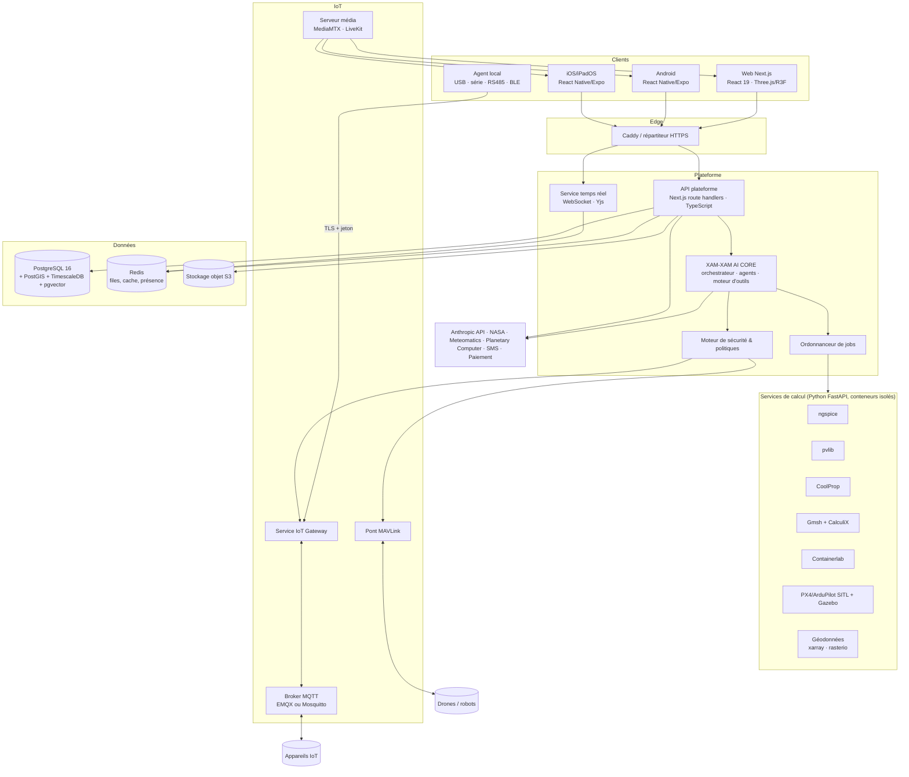
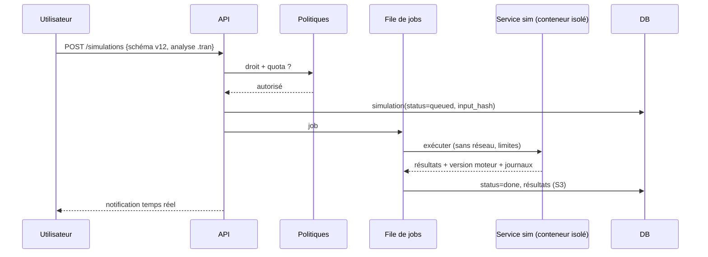
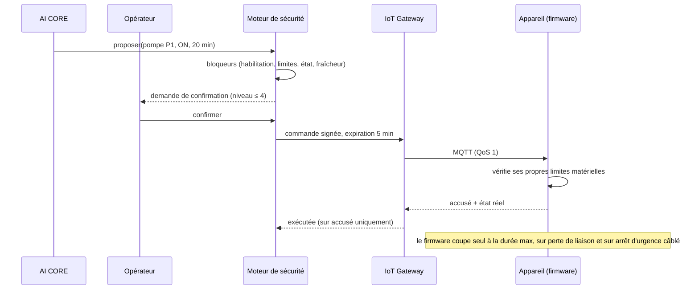

# 4. Architecture technique

## 4.1 Principes
1. **Modulaire** : un cœur de plateforme (comptes, projets, droits, i18n, audit) + services spécialisés (calcul, simulation, IoT, temps réel, IA).
2. **Ne pas réinventer les moteurs** : ngspice, pvlib, CoolProp, CalculiX/Gmsh, OpenCascade, PX4/ArduPilot SITL, Containerlab, Yjs, LiveKit, MQTT.
3. **Isolation** : toute exécution de moteur ou de code utilisateur dans un conteneur jetable, sans réseau par défaut, avec limites CPU/RAM/temps.
4. **Traçabilité** : chaque résultat = entrées + moteur + version + empreinte → reproductible.
5. **Indépendance** : XAM-XAM LAB possède son propre code, sa base, ses comptes, ses API, ses intégrations et sa configuration ; aucune dépendance envers un autre produit.

## 4.2 Vue d'ensemble


## 4.3 Choix technologiques

### Frontend web
Next.js 16 (App Router), React 19, TypeScript strict, Tailwind 4. 3D : **Three.js + React Three Fiber** (écosystème, compatibilité), moteur WebGPU de Three.js quand disponible avec repli WebGL2. Babylon.js écarté pour éviter deux moteurs. Schémas 2D : SVG/Canvas avec moteur de graphe dédié (ports, routage orthogonal). CAO : OpenCascade compilé en WebAssembly (aperçu, opérations légères) + opérations lourdes côté serveur. Édition collaborative : Yjs.

### Mobile — comparaison
| Critère | React Native (Expo) | Flutter |
|---|---|---|
| Partage avec le web | **Élevé** : TypeScript, schémas zod, client API, catalogues i18n, logique pure | Faible (Dart, tout à réécrire) |
| Performance UI | Bonne (nouvelle architecture) | Très bonne |
| 3D | R3F native via expo-gl (scènes modérées) ; scènes lourdes en WebView | Moteurs 3D moins mûrs |
| Caméra | expo-camera / vision-camera | camera |
| Bluetooth BLE | react-native-ble-plx | flutter_blue_plus |
| USB | Android : module natif USB Host ; **iOS : pas d'accès USB série générique** (accessoires MFi seulement) | Mêmes limites système |
| Notifications | expo-notifications (FCM/APNs) | firebase_messaging |
| Maintenance | Une équipe TypeScript pour web + mobile | Deux langages |

**Recommandation : React Native (Expo)**. Limites système à afficher dans l'application : sur iOS, pas de connexion USB/série directe → passer par Wi-Fi/BLE ou l'agent local ; Web Serial/Web USB/Web Bluetooth indisponibles dans Safari et Firefox → agent local ou application.

### Backend
- **API plateforme** : Next.js route handlers (TypeScript) — comptes, projets, droits, contenus, orchestration. Conventions (`src/server/api.ts`) : `endpoint()` (erreurs uniformes), `readInput` (zod), `mustBeSignedIn` / `mustBeAdmin`, `ok()` ; base : `sql` / `sqlOne`.
- **Services de calcul** : Python 3.12 + FastAPI, un service par famille de moteurs, appelés par jobs (pas directement par le navigateur).
- **Temps réel** : service Node.js dédié (WebSocket : présence, Yjs, télémétrie diffusée), Next.js n'étant pas adapté aux connexions longues.
- **Jobs** : Redis + BullMQ (côté Node) ; workers Python consomment via une file commune (contrat JSON versionné).

### Données
PostgreSQL 16 + PostGIS (géographie), **TimescaleDB** (séries de mesures et télémétrie), **pgvector** (mémoire/recherche sémantique de l'IA) — une seule base opérée. Redis (files, cache, présence, limites). Stockage objet S3 compatible (MinIO auto-hébergé ou fournisseur) pour fichiers, modèles 3D, vidéos, résultats volumineux. Sauvegardes chiffrées quotidiennes + restauration testée.

### Infrastructure
Docker Compose pour le pilote, puis Kubernetes quand la charge le justifie (jobs de simulation à mise à l'échelle automatique, nœuds GPU à la demande). Observabilité : OpenTelemetry, Prometheus/Grafana, journaux centralisés avec masquage des secrets. Secrets : variables serveur + chiffrement applicatif ; gestionnaire de secrets (Vault/équivalent) en production.

## 4.4 Organisation du code (monorepo recommandé, décision D1)
```
xamxam-lab/
  apps/web/            Next.js (plateforme web)
  apps/mobile/         Expo (Android + iOS)
  apps/realtime/       WebSocket, Yjs, présence, diffusion télémétrie
  apps/local-agent/    agent local (Node.js ou Go, binaire signé) — USB, série, RS485/Modbus, BLE
  services/sim-spice/  FastAPI + ngspice
  services/sim-solar/  FastAPI + pvlib
  services/sim-thermo/ FastAPI + CoolProp
  services/sim-fea/    FastAPI + Gmsh/CalculiX
  services/sim-net/    Containerlab
  services/sitl/       PX4/ArduPilot SITL + Gazebo
  services/iot-gateway/ MQTT, ingestion, commandes, MAVLink
  packages/shared/     types, schémas zod, contrats d'API
  packages/i18n/       catalogues WO/FR/EN, circuit de validation
  packages/eng-core/   calculs purs testés (électrotechnique, unités)
  packages/ai-core/    orchestrateur, registre d'agents et d'outils, politiques
  packages/integrations/ NASA, Meteomatics, etc.
  firmware/            XIAO ESP32-S3, station, modèles de firmware
  db/migrations/       SQL numérotées
  docs/
```

## 4.5 Architecture des API
- **REST JSON** versionnée `/api/v1/...` (OpenAPI générée depuis les schémas zod) ; **WebSocket** `/rt` pour le temps réel ; **MQTT** pour les appareils ; **WebRTC** pour audio/vidéo.
- Authentification : cookie de session `httpOnly` (web) ; jetons d'accès courts + jeton de rafraîchissement (mobile) ; jetons d'appareil hachés (IoT) ; clés d'API d'organisation (intégrations).
- Erreurs uniformes `{ error: { code, message_key, params } }` (clé traduisible).
- Idempotence : en-tête `Idempotency-Key` pour toute écriture rejouée hors ligne.

| Domaine | Ressources principales |
|---|---|
| Identité | `/auth/*`, `/users`, `/orgs`, `/memberships`, `/roles`, `/sessions`, `/mfa` |
| Projets | `/projects`, `/projects/:id/{members,documents,schematics,models,simulations,tasks,versions,reports}` |
| Labs | `/schematics/:id` (graphe), `/calc/{electrical,solar,thermo,mechanical,network}/*`, `/components` |
| Simulation | `/simulations` (création = job), `/simulations/:id` (statut, résultats, journaux), `/simulations/:id/cancel` |
| IA | `/ai/conversations`, `/ai/plans/:id/{approve,reject}`, `/ai/operations/:id/{suspend,cancel}`, `/ai/agents`, `/ai/memory` |
| IoT | `/devices`, `/devices/:id/{measurements,commands,firmware,token}`, `/ingest` (appareils), `/local-agents` |
| Automatisations | `/automations`, `/automations/:id/{runs,enable,disable}` |
| Télépilotage | `/rc/sessions`, `/rc/sessions/:id/{commands,handover,estop,replay}` |
| Earth & Space | `/geo/{power,smap,ndvi,forecast,gibs}` |
| Académie | `/courses`, `/lessons`, `/exercises`, `/submissions`, `/classes`, `/certificates` |
| Écosystème | `/startups`, `/challenges`, `/mentors`, `/bookings`, `/jobs`, `/applications`, `/posts`, `/listings` |
| Gouvernance | `/audit`, `/incidents`, `/permissions`, `/quotas`, `/command-center/*` |
| i18n | `/i18n/{export,import,validate}` |

## 4.6 Diagrammes de communication

### Lancement d'une simulation


### Commande d'un équipement réel


## 4.7 Synchronisation multi-appareils et hors ligne
- Objets éditables (schémas, documents, tableaux blancs) : **CRDT Yjs** persistés côté serveur → reprise sur n'importe quel appareil, fusion automatique des modifications hors ligne.
- Données structurées : file d'opérations idempotentes, conflits signalés (version optimiste).
- Calculs lourds : toujours côté serveur ; hors ligne, la demande est mise en file et le résultat arrive à la reconnexion (jamais de résultat simulé localement présenté comme le résultat serveur).
