# 5. XAM-XAM AI CORE — architecture multi-agents, autonomie, automatisation

## 5.1 Principe
Le cerveau central est un **système d'orchestration**, pas un modèle unique : un modèle de langage (Claude par API) comprend, planifie et rédige ; **les actions et calculs sont exécutés par des outils** dont le code est déterministe, testé et soumis aux politiques. L'IA ne déclare jamais avoir fait une opération que le moteur d'outils n'a pas enregistrée comme réussie (le compte rendu est généré à partir du journal d'exécution, pas de la mémoire du modèle).

## 5.2 Les 10 sous-systèmes
| # | Sous-système | Rôle | Réalisation |
|---|---|---|---|
| A | Reasoning Engine | Comprendre (WO/FR/EN), analyser, détecter les informations manquantes, planifier | Appel LLM « planificateur » à sortie structurée (plan JSON validé par schéma) |
| B | Agent Orchestrator | Répartir les étapes entre agents, gérer dépendances et parallélisme, consolider | Machine à états persistée (`ai_plans`, `ai_steps`) ; reprise après panne |
| C | Tool Execution Engine | Exécuter les outils autorisés (API internes, moteurs, services externes) | Registre d'outils typé (zod/JSON Schema), délais, réessais, idempotence, journal |
| D | Device Connectivity Engine | Découvrir/identifier/superviser les appareils | Outils en lecture sur IoT Gateway ; écriture uniquement via le moteur de sécurité |
| E | Automation Engine | Créer/exécuter des scénarios | Compilateur scénario → graphe d'états exécuté par un ordonnanceur (pas par le LLM) |
| F | Remote Operations Engine | Sessions de télépilotage, télémétrie, commandes autorisées | Outils de haut niveau (mission, retour) ; jamais de pilotage bas niveau par le LLM |
| G | Simulation Engine | Préparer, lancer, analyser des simulations | Outils `simulate_*` → jobs ; analyse = post-traitement déterministe + interprétation signalée |
| H | Memory & Knowledge Engine | Mémoire de projet, connaissances, décisions | PostgreSQL + pgvector ; chaque souvenir a source, auteur, date, visibilité ; respect des droits |
| I | Safety & Governance Engine | Autorisations, risques, validation humaine, audit | Politiques évaluées **hors LLM** avant chaque outil ; journal immuable |
| J | Communication Engine | Utilisateurs, agents, équipements, services externes | Notifications, messages inter-agents structurés, webhooks |

## 5.3 Flux d'une demande

```mermaid
flowchart LR
  Q[Demande WO/FR/EN<br/>texte ou voix] --> STT{Voix ?}
  STT -->|oui| ASR[Reconnaissance vocale<br/>transcription affichée et corrigeable]
  STT -->|non| R
  ASR --> R[A · Reasoning<br/>intention, manques, risques]
  R -->|infos manquantes| ASK[Questions à l'utilisateur]
  R --> P[Plan structuré<br/>étapes · agents · outils · autorisations]
  P --> G{I · Gouvernance<br/>niveau d'autonomie}
  G -->|approbation requise| H[Validation humaine]
  G -->|préautorisé| O
  H --> O[B · Orchestrateur]
  O --> AG1[Agent Solar] & AG2[Agent Electrical] & AG3[Agent IoT]
  AG1 & AG2 & AG3 --> T[C · Moteur d'outils<br/>contrôle de politique à chaque appel]
  T --> RES[Résultats typés + nature + source]
  RES --> V[Agent vérificateur<br/>unités, cohérence, hypothèses]
  V --> REP[Compte rendu généré depuis le journal]
```

## 5.4 Agents spécialisés
Un agent = **configuration versionnée** : instructions système, domaine, base de connaissances (documents sources vérifiés), **liste blanche d'outils**, méthodes de vérification, limites, permissions, historique. Les agents partagent le même fournisseur de modèle ; la spécialisation vient des outils et des connaissances, pas d'un modèle différent.

| Agent | Outils principaux | Vérifications | Limites explicites |
|---|---|---|---|
| Electrical Engineer | `calc_current`, `calc_cable_section`, `calc_voltage_drop`, `calc_short_circuit`, `erc_check`, `draft_schematic`, `simulate_spice` | Cohérence unités, protections présentes, coefficients normatifs disponibles | Pas de validation réglementaire d'une installation (nécessite un professionnel habilité) |
| Electronics Engineer | `component_search`, `simulate_spice`, `erc_check`, `compile_firmware` | Calibres vs fiche technique, polarisation | Firmware : modèles testés uniquement en téléversement |
| Solar Energy Engineer | `get_irradiance` (NASA POWER/Meteomatics), `pv_production` (pvlib), `size_battery`, `check_mppt_window`, `pump_sizing`, `financials` | Plages MPPT, DoD, pertes | Prix = données utilisateur |
| IoT Engineer | `device_list`, `device_readings`, `wiring_check`, `firmware_template`, `register_device` | Tensions 3,3/5 V, brochage | Commande = proposition |
| Robotics Engineer | `kinematics`, `simulate_motion`, `rc_propose_mission` | Espace de travail, collisions | Réel : opérateur requis |
| Drone Engineer | `sitl_run`, `flight_plan_check`, `battery_budget`, `rc_propose_mission` | Géorepérage, autonomie, météo | Opération réelle soumise à habilitation et autorisation ANACIM |
| Mechanical Engineer | `cad_op`, `fea_run`, `gear_calc`, `motion_sim` | Maillage, conditions aux limites | Résultats FEA = simulation, validation physique requise |
| Refrigeration Engineer | `refprop_state` (CoolProp), `cycle_calc`, `cold_room_load` | Fluide, domaine de validité | Manipulation de fluides : professionnel certifié |
| Computer & Network Engineer | `subnet_calc`, `netlab_deploy`, `netlab_exec` | Conflits d'adressage | Laboratoire fermé uniquement |
| Cybersecurity Analyst | `config_audit`, `threat_model`, `log_query` | Défensif uniquement | Aucune action offensive hors laboratoire autorisé |
| GIS & Satellite Analyst | `get_power`, `get_smap`, `get_ndvi`, `get_forecast`, `gibs_layer` | Fraîcheur, résolution, licence | Pas d'interpolation présentée comme mesure |
| Research Assistant | `literature_search` (sources ouvertes : Crossref, OpenAlex, arXiv), `doi_resolve` | Référence résolue | Aucune référence non vérifiée |
| Education Tutor | `course_context`, `exercise_hint`, `explain_component` | Adapté au niveau | En évaluation : indices, pas de solution |
| Startup Mentor | `bmc_template`, `market_sources`, `milestones` | Sources citées | Pas de conseil juridique/financier certifié |
| Talent & Career Assistant | `skill_match`, `profile_review` | Critères non discriminatoires | Profils consentants uniquement |
| + Software Engineer (cité §5.4 du cahier) | `dashboard_generate`, `code_review` | Tests générés exécutés | — |
| + Vérificateur (transverse) | `unit_check`, `consistency_check` | — | Ne produit pas, contrôle |

Collaboration : messages structurés `{from, to, step_id, kind: request|result|question|objection, payload}` via l'orchestrateur (pas de dialogue libre non tracé). Un agent peut **objecter** (ex. le Solar Engineer signale une chute de tension excessive au Electrical Engineer) ; l'orchestrateur arbitre ou remonte à l'utilisateur.

## 5.5 Niveaux d'autonomie
| Niveau | Ce que l'IA peut faire | Validation humaine |
|---|---|---|
| 1 Assistance | Expliquer, répondre, lire les données autorisées | — |
| 2 Préparation | Produire schémas, calculs, codes, plans de simulation (brouillons) | Pour enregistrer dans le projet |
| 3 Exécution numérique | Lancer simulations, générer rapports, créer tâches, modifier des objets numériques | Plan approuvé |
| 4 Automatisation supervisée | Exécuter des scénarios ; proposer des commandes physiques | **Chaque commande physique** confirmée |
| 5 Surveillance continue | Exécuter des scénarios préautorisés dans des limites (durée, plages, valeurs, appareils) | Préautorisation écrite, révocable ; arrêt immédiat sur anomalie |

Le niveau effectif = **minimum** des niveaux accordés par utilisateur, projet, appareil et opération. Aucun niveau ne permet de : modifier les limites matérielles, désactiver un arrêt d'urgence, s'accorder des permissions, contourner une habilitation, agir hors des appareils listés.

## 5.6 AI Automation Studio
Structure obligatoire d'un scénario : **Déclencheur** (mesure, horaire, événement, manuel) → **Condition(s)** → **Action(s)** → **Temporisation** → **Vérification** (résultat attendu mesuré) → **Notification** → **Journalisation** → **Arrêt** (condition de fin + délai maximal + arrêt sur perte de données).

- Création : éditeur visuel (blocs reliés) **ou** langage naturel → l'IA produit le graphe → l'utilisateur le voit, le modifie, le valide. Le scénario validé est exécuté par l'ordonnanceur déterministe, pas par le LLM.
- Seuils : jamais par défaut ; une règle sans donnée fraîche n'est pas déclenchée (règle du dépôt).
- Mode **essai à blanc** obligatoire avant activation : rejoue l'historique des mesures et montre ce qui aurait été déclenché.

## 5.7 Coûts et maîtrise de l'IA
- Routage par complexité : Haiku 5.5 (classification, extraction), Sonnet 5.5 (agents), Opus 5.5 (planification complexe, revue).
- Mise en cache des invites (instructions d'agents stables), quotas par offre/utilisateur/organisation, plafond journalier, coût affiché par opération dans le Command Center.
- Sans fournisseur IA disponible : moteur de règles **explicitement signalé**, les labos et calculs restent utilisables sans IA.

## 5.8 Tests de l'AI CORE
- Outils : tests unitaires déterministes.
- Agents : jeux d'évaluation par domaine (questions → outils attendus, refus attendus, demande d'informations manquantes), exécutés à chaque changement d'instructions.
- Sécurité : tests d'injection d'instructions (documents et pages contenant des ordres), tentatives d'élévation d'autonomie, commandes hors limites → doivent être bloquées par le moteur de politiques, indépendamment de la réponse du modèle.
- Fournisseur : `fetchImpl` explicites (règle du dépôt), aucun succès simulé.
