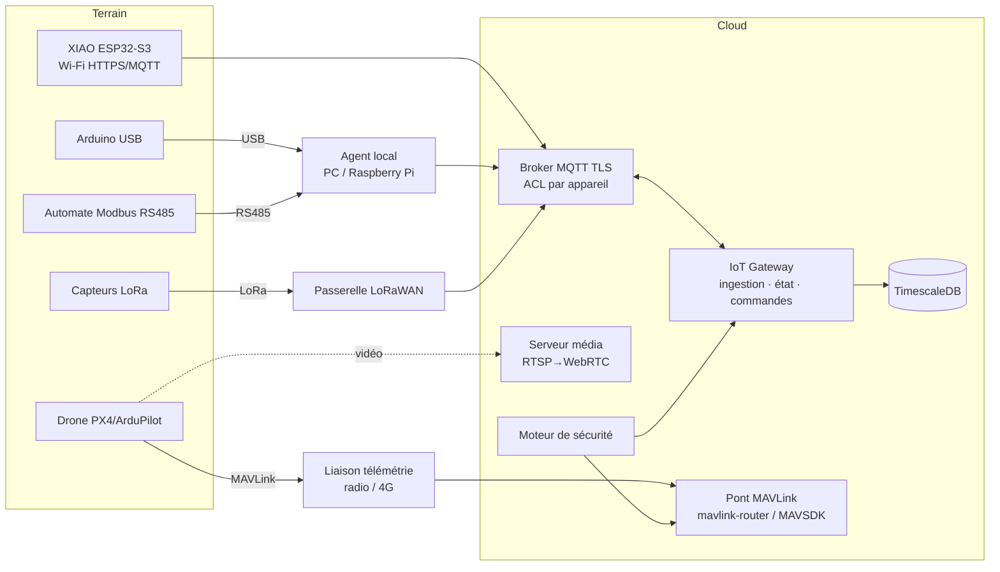

# 7. Connexion matérielle (IoT Gateway) et télépilotage (Remote Control Center)

## 7.1 Ce qui est possible depuis un navigateur — et ce qui ne l'est pas
| Liaison | Navigateur Chromium (Chrome/Edge, Android Chrome) | Safari / Firefox / iOS | Solution |
|---|---|---|---|
| USB série (Arduino, ESP32, XIAO) | Web Serial | Non | Agent local / application Android |
| USB générique | WebUSB (limité) | Non | Agent local |
| BLE | Web Bluetooth (partiel) | Non (Safari) | Application mobile / agent local |
| RS232/RS485/Modbus RTU | Via adaptateur USB + Web Serial (limité) | Non | **Agent local** (recommandé) |
| Ethernet / Modbus TCP | Non (pas de socket brute) | Non | Agent local ou passerelle |
| Wi-Fi HTTP / MQTT sur WebSocket | Oui | Oui | Direct vers l'IoT Gateway |
| LoRa | Non | Non | Passerelle LoRaWAN (ChirpStack/équivalent) → MQTT |
| Cellulaire | — | — | Appareil avec modem → MQTT/HTTPS |

Ces limites sont affichées dans l'assistant « Ajouter un appareil » ; jamais de fausse connexion.

## 7.2 Architecture

### Modèle d'appareil
Identifiant, propriétaire, organisation, **capacités** déclarées (mesures : métrique, unité, période ; commandes : action, paramètres, bornes), protocole, état (`online`/`stale`/`offline`/`disabled`, fraîcheur), permissions, historique, version de firmware.

### Sujets MQTT
`xx/{org}/{device}/telemetry` (appareil → cloud), `xx/{org}/{device}/state`, `xx/{org}/{device}/cmd` (cloud → appareil), `xx/{org}/{device}/ack`. ACL : un appareil ne publie/lit que ses propres sujets ; authentification par certificat client ou jeton haché.

### Agent local
Binaire signé (Windows, macOS, Linux, Raspberry Pi), appairé au compte par code à usage unique, connexion sortante TLS uniquement (aucun port ouvert), accès aux ports série/USB/RS485/Modbus/BLE **autorisés explicitement** par l'utilisateur sur sa machine. Il relaie mesures et commandes et applique localement une liste blanche des commandes.

### Gestion des erreurs
Reconnexion exponentielle, file locale côté appareil, horodatage à la mesure, détection de valeurs figées/incohérentes, mises à jour de firmware signées avec retour arrière.

## 7.3 Remote Control Center

### Trois modes strictement séparés
| Mode | Cible | Contrôles |
|---|---|---|
| Simulation virtuelle | PX4/ArduPilot SITL + Gazebo, jumeau numérique | Libre (quotas) ; badge `SIMULATION` |
| Banc d'essai physique | Matériel réel fixé, hélices retirées ou charge simulée | Habilitation banc, limites réduites, superviseur |
| Opération réelle | Matériel en conditions réelles | Habilitation nominative, autorisations réglementaires jointes, check-list pré-opération, pilote responsable identifié, limites opérationnelles, journal complet |

Une session ne peut pas changer de mode : passer du banc au réel = nouvelle session et nouvelles vérifications.

### Chaîne de commande (défense en profondeur)
1. **Interface** : commandes de haut niveau seulement, bornes affichées.
2. **Moteur de sécurité (serveur)** : habilitation, mode, limites, état/fraîcheur de l'appareil, niveau d'autonomie, expiration des commandes.
3. **Passerelle/pont** : liste blanche des messages (ex. MAVLink : modes et missions ; pas d'écriture de paramètres de sécurité).
4. **Autopilote/firmware** : protections natives **non modifiables depuis la plateforme** — géorepérage, retour automatique sur perte de liaison ou batterie faible (failsafes PX4/ArduPilot), durée maximale de marche des pompes, chien de garde.
5. **Matériel** : arrêt d'urgence câblé, disjoncteurs, fins de course, interrupteur de sécurité.

L'IA intervient seulement au niveau 1–2 (proposition) ; jamais au-dessous.

### Vidéo et télémétrie
Vidéo : RTSP/RTP de l'appareil → serveur média (MediaMTX ou LiveKit) → WebRTC (latence affichée). Télémétrie : MAVLink → pont → WebSocket ; enregistrement dans `rc_events` pour relecture. Pas de vidéo → « flux indisponible », jamais d'image de remplacement.

### Transfert de contrôle et reprise sûre
Un seul pilote actif ; demande de transfert acceptée explicitement ; sur perte de l'opérateur (interface fermée, réseau), l'appareil applique son propre comportement de sécurité (stationnaire/retour/atterrissage selon configuration de l'autopilote), la plateforme notifie et journalise.

### Réglementation
Drones au Sénégal : réglementation de l'ANACIM (enregistrement, autorisations selon catégorie et zone) — le module ne fournit pas l'autorisation, il **exige** sa référence avant une session réelle. Équipements électriques : installation par un professionnel habilité.
