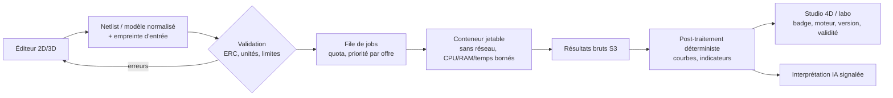

# 8. Architecture de simulation (2D / 3D / 4D, Digital Twin)

## 8.1 Trois natures distinctes, toujours affichées
| Nature | Définition | Exemple | Badge |
|---|---|---|---|
| Animation visuelle | Représentation sans calcul physique | Flèches de courant animées, rotation d'un moteur pour illustrer | `ANIMATION` |
| Physique temps réel | Approximation numérique interactive (pas de garantie quantitative) | Collisions et chute d'objets (Rapier), mouvements d'un bras | `PHYSIQUE TEMPS RÉEL` |
| Simulation numérique | Solveur reconnu, résultats quantitatifs avec domaine de validité | ngspice, pvlib, CoolProp, CalculiX, PX4 SITL | `SIMULATION NUMÉRIQUE` + moteur/version |
| Mesure | Donnée d'un appareil réel | Capteur de courant | `MESURE` |

## 8.2 Moteurs par domaine (solutions reconnues, pas de moteur maison)
| Domaine | Moteur | Licence (à confirmer juridiquement) | Exécution |
|---|---|---|---|
| Circuits électriques/électroniques | **ngspice** | BSD modifiée / libre | Serveur (conteneur) ; WebAssembly à évaluer pour petits circuits interactifs |
| Logique de commande (relais, contacteurs) | Simulateur à événements discrets (code maison simple, testé) | — | Navigateur |
| Photovoltaïque | **pvlib-python** | BSD-3 | Serveur |
| Thermodynamique, fluides frigorigènes | **CoolProp** | MIT | Serveur (et WASM possible) |
| CAO | **OpenCascade** (opencascade.js / replicad) | LGPL avec exception | Navigateur + serveur |
| Maillage / éléments finis | **Gmsh** + **CalculiX** | GPL (services isolés, non liés au code de la plateforme) | Serveur |
| Physique temps réel | **Rapier** (WASM) | Apache-2.0 | Navigateur |
| Réseaux | **Containerlab** + FRRouting ; **ns-3** (phase ultérieure) | BSD-3 / GPL | Serveur isolé |
| Drones / robots | **PX4 SITL**, **ArduPilot SITL**, **Gazebo** | BSD-3 / GPL-3 / Apache-2.0 | Serveur (GPU optionnel) |
| Microcontrôleurs | Compilation PlatformIO/arduino-cli ; co-simulation à évaluer | divers | Serveur |

## 8.3 Pipeline d'exécution

- Reproductibilité : `input_hash` + `engine_version` → même résultat ; un résultat en cache est réutilisé et signalé.
- Domaine de validité : chaque outil déclare ses hypothèses (ex. pvlib : modèle de transposition, données horaires NASA POWER à résolution régionale).
- Échec du solveur (non-convergence…) : journal affiché, jamais de résultat partiel présenté comme complet.

## 8.4 4D et Digital Twin
- Frise temporelle unique où se superposent : résultats de simulation (pas de temps du solveur), mesures réelles (horodatage appareil), événements (commandes, alertes).
- **Comparaison simulation/réalité** : écarts calculés sur les instants communs (interpolation signalée), indicateurs (erreur moyenne, maximale).
- Digital Twin = modèle versionné + correspondance capteurs↔variables du modèle + état de synchronisation (`synchronisé`, `données anciennes`, `capteur manquant`). Aucun capteur manquant n'est remplacé silencieusement par une valeur simulée.

## 8.5 Rendu
Three.js/R3F, WebGPU si disponible sinon WebGL2 ; niveaux de détail ; mode « performance » pour les téléphones ; alternative tabulaire/2D accessible. Les scènes immersives sont alimentées par les données réelles du projet (modèles, mesures), pas par des décors figés.
