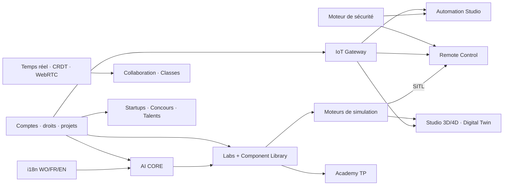

# 12. Dépendances, difficultés, coûts et contraintes réelles

Les montants ci-dessous sont des **ordres de grandeur à confirmer par devis** ; seuls les tarifs marqués « publié » proviennent d'une source vérifiable.

## 12.1 Dépendances techniques critiques

Chemin critique vers les opérations réelles : comptes → moteur de sécurité → IoT Gateway → SITL/banc → audit → réel.

## 12.2 Difficultés majeures
| Difficulté | Pourquoi | Réponse |
|---|---|---|
| Ampleur | 26 rubriques, 3 plateformes, 15 agents, 10+ moteurs | Phasage, monorepo, réutilisation de moteurs reconnus |
| Wolof technique | Peu de corpus et de terminologie scientifique validée ; ASR wolof immature | Validateurs dès la phase 1, glossaire « conserver le terme », évaluation mesurée de l'ASR |
| Données normatives | Tableaux NF C 15-100/CEI protégés par droit d'auteur | Achat des normes, saisie par ingénieur qualifié, pas de diffusion des tableaux complets |
| Données composants | Fiches techniques hétérogènes, licences des modèles SPICE/3D | Bibliothèque progressive, statut `vérifié`, licences tracées |
| Accès matériel depuis le web | API limitées à Chromium, absentes sur iOS | Agent local + application mobile |
| Sécurité physique | Responsabilité en cas d'accident | Défense en profondeur, habilitations, assurances, revues de sécurité |
| 3D sur téléphones d'entrée de gamme | GPU limités, données mobiles chères | Niveaux de détail, mode 2D, calcul côté serveur, cache |
| Connectivité | Coupures, coûts data | Hors ligne, synchronisation différée, contenus allégés |
| Coût IA et calcul | Croît avec l'usage gratuit | Quotas, routage de modèles, cache |
| Réglementation | Drones (ANACIM), données (CDP), paiements | Intégrée aux parcours ; avis juridique |

## 12.3 Coûts
### Coûts publiés (vérifiables)
- Apple Developer Program : 99 USD/an ; Google Play Console : 25 USD une fois.
- Claude Opus 5.5 : 4 USD / million de jetons en entrée, 20 USD en sortie (source : `docs/AI_AGENT.md` de ce dépôt) ; Sonnet et Haiku moins chers (consulter la grille tarifaire en vigueur).

### Ordres de grandeur (à confirmer)
| Poste | Pilote (MVP, < 1 000 utilisateurs) | Croissance |
|---|---|---|
| Hébergement (VPS/cloud : API, base, broker, stockage) | quelques dizaines à quelques centaines USD/mois | milliers USD/mois |
| Calcul de simulation (CPU ; GPU pour SITL/Gazebo/rendu) | à la demande, plafonné | dominant avec l'usage |
| IA | dépend des quotas ; plafond journalier configurable | dominant avec l'usage gratuit |
| Visioconférence (SFU auto-hébergé ou service) | bande passante | important |
| Normes électriques (achat) | quelques centaines d'euros | — |
| Matériel de banc (cartes, capteurs, relais, onduleur de test, drone de test) | quelques milliers USD | — |
| Équipe | **poste principal** | — |
| Validation linguistique, experts métier | temps partiel rémunéré | — |
| Test d'intrusion, assurance, juridique | avant ouverture publique et opérations réelles | — |

## 12.4 Contraintes réelles à respecter
- Fraîcheur, résolution, licences et quotas des sources (NASA POWER : données modélisées régionales ; SMAP ~9 km ; Meteomatics : contrat ; Sentinel-2 : couverture nuageuse).
- Aucune simulation présentée comme mesure, aucune animation présentée comme simulation.
- Matériel : aucune commande « exécutée » sans accusé du matériel.
- Traductions : aucune traduction nationale inventée.
- Le gratuit doit rester soutenable : quotas visibles.

## 12.5 Risques et parades
| Risque | Probabilité | Impact | Parade |
|---|---|---|---|
| Dispersion (tout commencer à la fois) | Élevée | Élevé | Validation phase par phase |
| Indisponibilité des validateurs wolof | Moyenne | Élevé | Recrutement précoce, contrats, partenariat universitaire |
| Accident lors d'une opération réelle | Faible | Critique | Phase 6 conditionnée à audit, banc, habilitations |
| Coûts IA non maîtrisés | Moyenne | Élevé | Quotas, routage, plafonds |
| Dépendance à un fournisseur d'IA | Moyenne | Moyen | Interface fournisseur abstraite, labos utilisables sans IA |
| Licences incompatibles (GPL) | Moyenne | Moyen | Moteurs GPL exécutés comme services séparés ; revue juridique |
