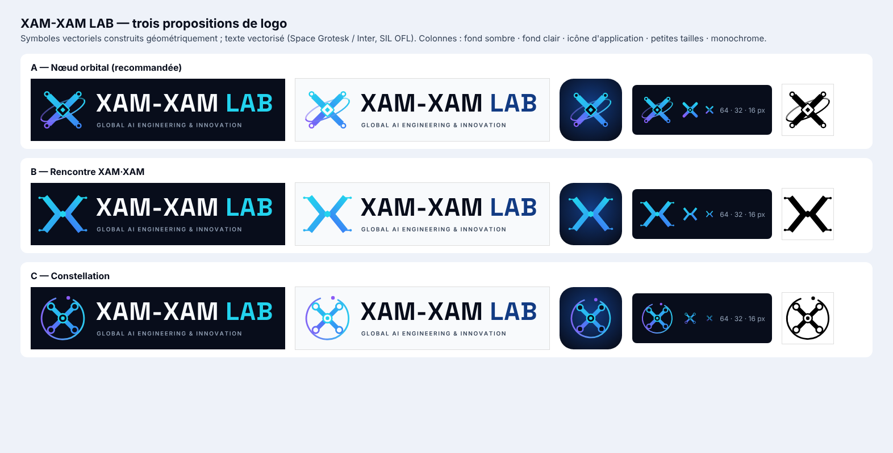

# Identité visuelle — XAM-XAM LAB (proposition du 17/11/2026, **en attente de validation**)

Réalisée d'après le document « XAM-XAM LAB — Design, identité, logo, icône » fourni par l'exploitant. Conformément à son § 13, **rien n'est encore intégré à l'application** : l'exploitant valide d'abord le logo, l'icône et le tableau de bord ; une seule commande applique ensuite les icônes (voir § 8).

Tout se trouve dans [`design/identite/`](../design/identite) et se régénère par scripts (aucune image générée par IA n'est utilisée comme logo).

## 1. Trois propositions de logo

| | Idée | Forces | Limites |
|---|---|---|---|
| **A — Nœud orbital** | X formé de deux pistes de circuit terminées par des pastilles ; noyau d'IA losange au centre ; orbite tissée (passe derrière puis devant le X) | Exprime les trois idées demandées (circuit, orbite/écosystème, noyau d'IA) ; reconnaissable ; version petit format dédiée | Le plus détaillé des trois : exige la variante simplifiée sous 32 px |
| **B — Rencontre XAM·XAM** | Deux chevrons qui se font face — deux savoirs qui se rencontrent — forment le X ; noyau hexagonal ; traces de circuit | Très lisible en petit ; évoque le nom redoublé « XAM-XAM » | L'orbite et l'IA sont moins présentes |
| **C — Constellation** | X formé d'un réseau de quatre nœuds reliés à un noyau, dans une orbite ouverte portant un satellite | Évoque le réseau, l'écosystème, l'espace | Le X se lit moins vite ; plus proche des pictogrammes « réseau » courants |

**Recommandation : A — Nœud orbital.** C'est la seule qui réunit lisiblement les trois idées du cahier (circuit électronique, orbite/écosystème, noyau central d'IA) autour d'un X géométrique ; elle reste reconnaissable en monochrome et dispose d'une variante simplifiée (X + noyau) pour les favicons. Les déclinaisons complètes ont été préparées pour A ; elles seront refaites pour B ou C en une commande si l'exploitant en décide autrement (`generer.py`, variable `r`).

## 2. Déclinaisons (proposition A)
| Fichier (`design/identite/svg/`) | Usage |
|---|---|
| `logo-horizontal-sombre.svg` / `-clair.svg` / `-transparent.svg` | En-têtes, documents, présentations |
| `logo-horizontal-mono-noir.svg` / `-mono-blanc.svg` | Impression une couleur, gravure, tampons |
| `logo-vertical-sombre.svg` / `-clair.svg` | Écran de démarrage, affiches, couvertures |
| `symbole.svg`, `symbole-mono-noir.svg` | Symbole seul |
| `symbole-petit-format.svg` | ≤ 32 px (sans orbite ni pastilles) |
| `icone-application.svg` | Icône Android / iOS (carré plein, l'OS applique sa forme) |
| `icone-android-avant-plan.svg` | Avant-plan de l'icône adaptative Android (zone sûre 66 dp) |
| `icone-favicon.svg` | Favicon et petites icônes |

Exports (`node design/identite/exporter.mjs`) : PNG transparents haute résolution (`export/png`, non versionnés, régénérables), **PDF vectoriels** (`export/pdf`, texte en tracés, aucune image), icônes Android (`mipmap-mdpi` → `xxxhdpi`, rondes, avant-plan, Play Store 512), iOS (1024 × 1024 opaque), web (favicon.ico 16/32/48, `icon.svg`, 180, 192, 512). Sources éditables : `generer.py` (géométrie paramétrée) et les SVG.

**Règles d'usage** : zone de protection autour du logo = hauteur du noyau losange ; largeur minimale du logo horizontal 120 px (écran) / 30 mm (impression) ; en dessous de 32 px, utiliser `symbole-petit-format` ; sur téléphone, l'en-tête n'affiche que le symbole (le logo horizontal élargirait la barre) ; ne pas déformer, recolorer hors palette, ajouter d'ombre ni placer sur une photo chargée sans voile sombre.

## 3. Palette
| Couleur | Code | Rôle |
|---|---|---|
| Bleu nuit | `#080D1B` | Fond principal (mode sombre) |
| Bleu ingénierie | `#123B83` | Structure, éléments actifs, « LAB » sur fond clair |
| Cyan technologique | `#22D3EE` | IA et interaction (accent) — `#0E7490` en mode clair pour le contraste |
| Violet innovation | `#8B5CF6` | Accents, agents (accent limité) |
| Blanc technique | `#F8FAFC` | Textes (sombre), fond (clair) |
| Vert fonctionnel | `#22C55E` | États réellement positifs uniquement |

Le cyan et le violet ne servent jamais de fond permanent ; aucune information n'est portée par la seule couleur (libellé ou icône associés — déjà le cas des pastilles de nature des données dans l'application).

## 4. Typographie
Space Grotesk (titres), Inter (interface), JetBrains Mono (code, mesures, valeurs) — polices libres SIL OFL, **auto-hébergées** (`design/identite/polices/`, licences jointes) : aucune requête vers un service tiers, conforme à la politique de sécurité de l'application.

## 5. Design system
Jetons proposés : [`design/identite/jetons.css`](../design/identite/jetons.css) (couleurs des deux modes, polices, échelle de tailles, rayon, cible tactile 44 px). Ils reprennent les noms de variables déjà utilisés par l'application (`--bg`, `--panel`, `--cyan`…) : l'intégration consistera à remplacer les valeurs de `src/app/globals.css`, sans réécrire les pages. Composants existants qui en héritent : `Page`, `Card`, `Btn`, `Field`, `Pill`, `Nature`, `Unavailable`, `ErrorBox`, `CalcView`, `LineChart` (`src/components/ui.tsx`), barre latérale et en-tête (`LabShell`).

## 6. Maquettes (vraies pages, aucune fonctionnalité inventée)
`node design/identite/maquettes.mjs` ouvre l'application réelle, s'inscrit, lance une vraie simulation ngspice, puis applique les jetons et le logo proposés dans le navigateur. Captures dans `design/identite/maquettes/` :

| Écran | Sombre | Clair |
|---|---|---|
| Tableau de bord (ordinateur) | `tableau-de-bord-sombre.png` | `tableau-de-bord-clair.png` |
| Electronics Lab (simulation RC réelle) | `labo-electronique-sombre.png` | `labo-electronique-clair.png` |
| Panneau XAM-XAM AI CORE | `xamxam-ai-sombre.png` | `xamxam-ai-clair.png` |
| Tableau de bord (Pixel 7) | `mobile-tableau-de-bord-sombre.png` | `mobile-tableau-de-bord-clair.png` |

L'organisation décrite au § 8 du cahier (barre latérale, barre supérieure avec langues WO/FR/EN, zone centrale) existe déjà ; le panneau contextuel droit et la barre d'état inférieure sont **à concevoir après validation** (non représentés pour ne pas montrer de fonctionnalité absente).

## 7. Fonds d'écran personnalisés (portrait du propriétaire)
`node design/identite/fonds.mjs <portrait-detoure.png> <dossier>` : **montage photographique** du portrait original (fond blanc retiré par remplissage depuis les bords ; visage, coiffure, teint et tenue inchangés ; aucune régénération ni retouche du visage) sur une scène vectorielle XAM-XAM. Formats : ordinateur 16:9 (3840 × 2160, zone libre à gauche pour les icônes), smartphone vertical (1290 × 2796, haut et bas dégagés), bannière de couverture (1584 × 396), visuel de profil (1080 × 1080), chacun avec et sans texte.
Le portrait étant une donnée personnelle, **ni la photo ni les fonds ne sont versionnés** ; ils ont été remis directement à l'exploitant.

## 8. Après validation
1. Indiquer la proposition retenue (A, B ou C) et les retouches souhaitées.
2. `python3 design/identite/generer.py && node design/identite/exporter.mjs --appliquer` : icônes web (`public/`), Android (`mipmap-*`, fond `#080D1B`) et iOS (`AppIcon`).
3. Reporter `jetons.css` dans `src/app/globals.css`, remplacer le texte « XAM-XAM LAB » de l'en-tête par le logo, relancer les parcours e2e (dont « aucune page plus large que l'écran »), recompiler l'APK.
